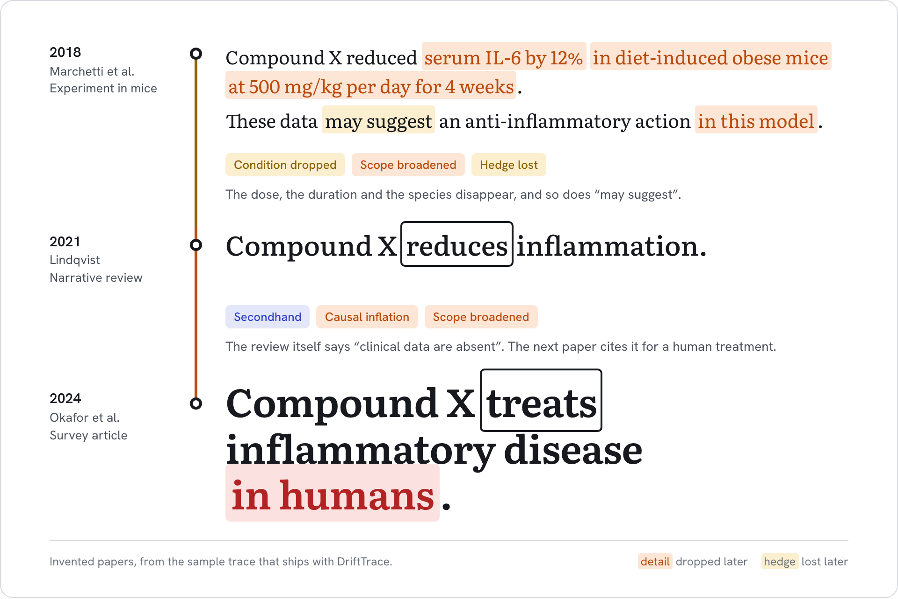
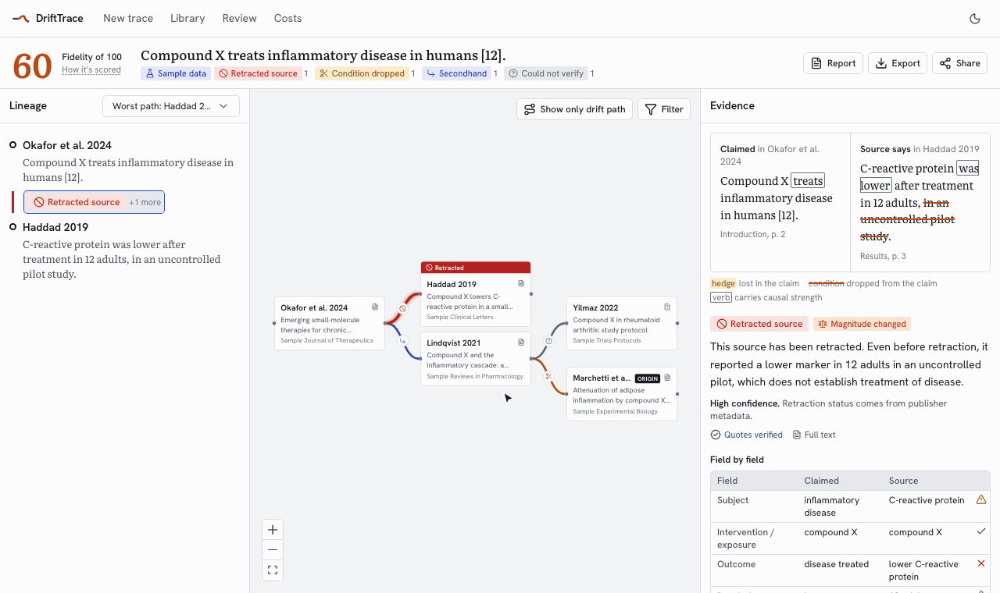
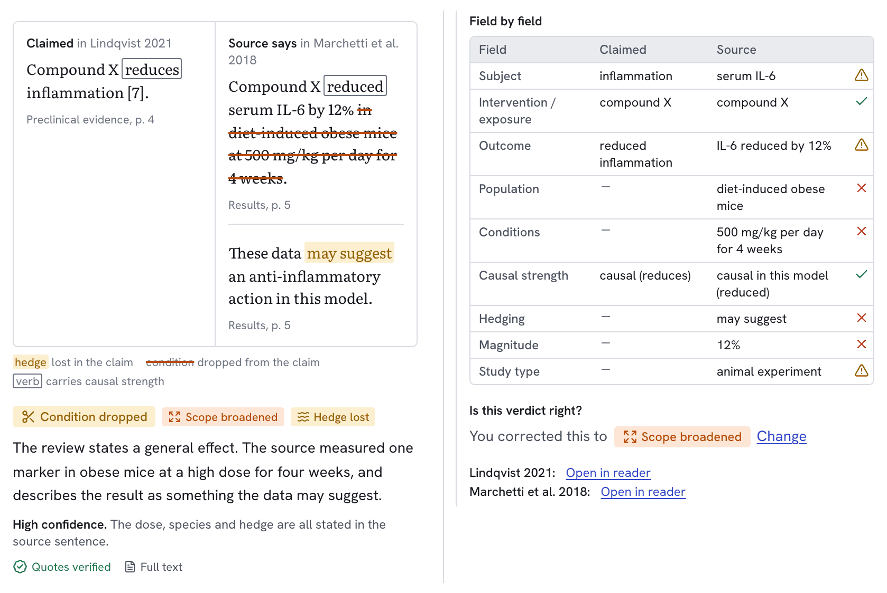
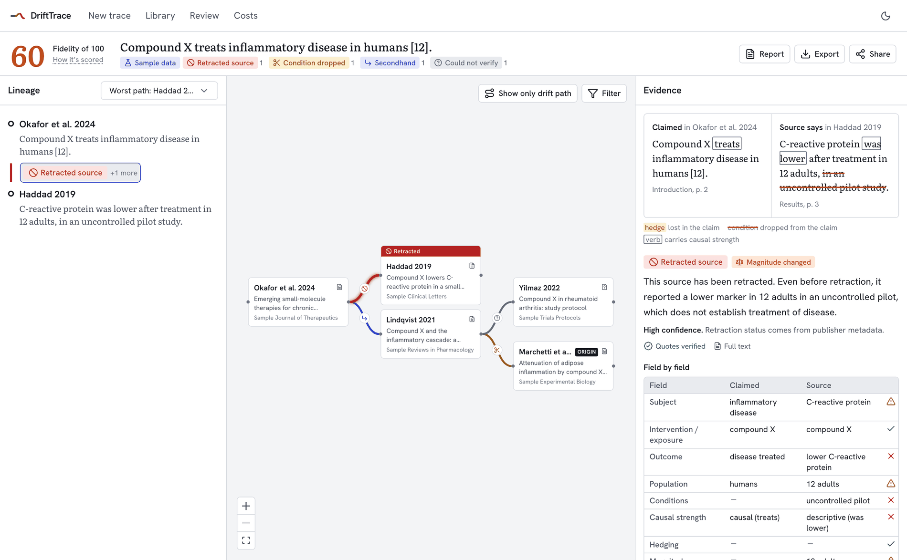
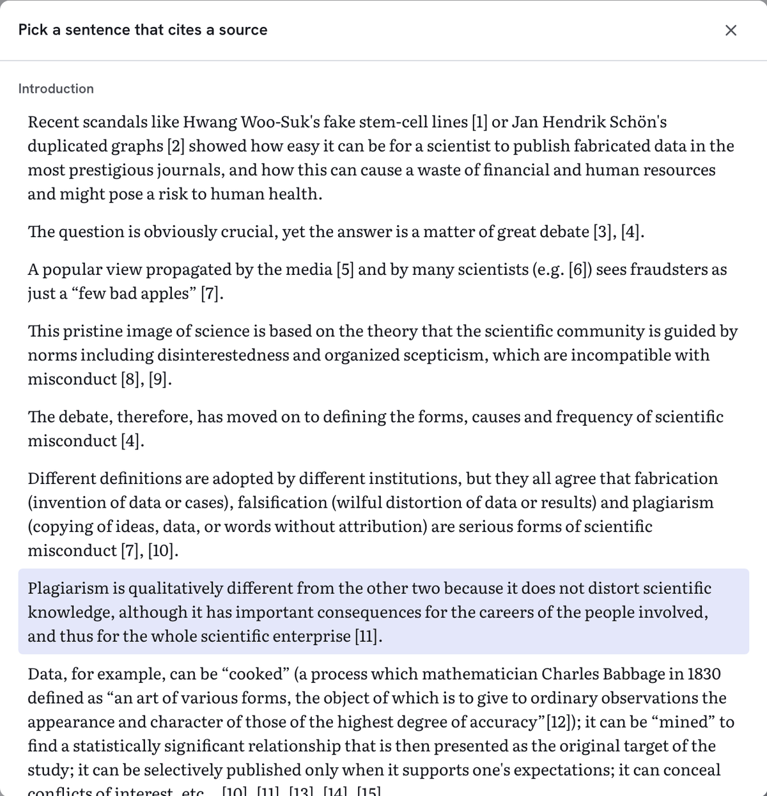
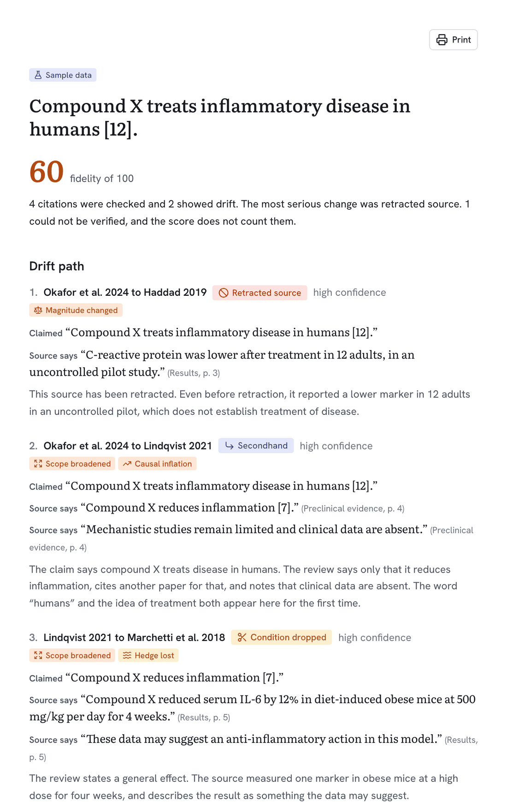
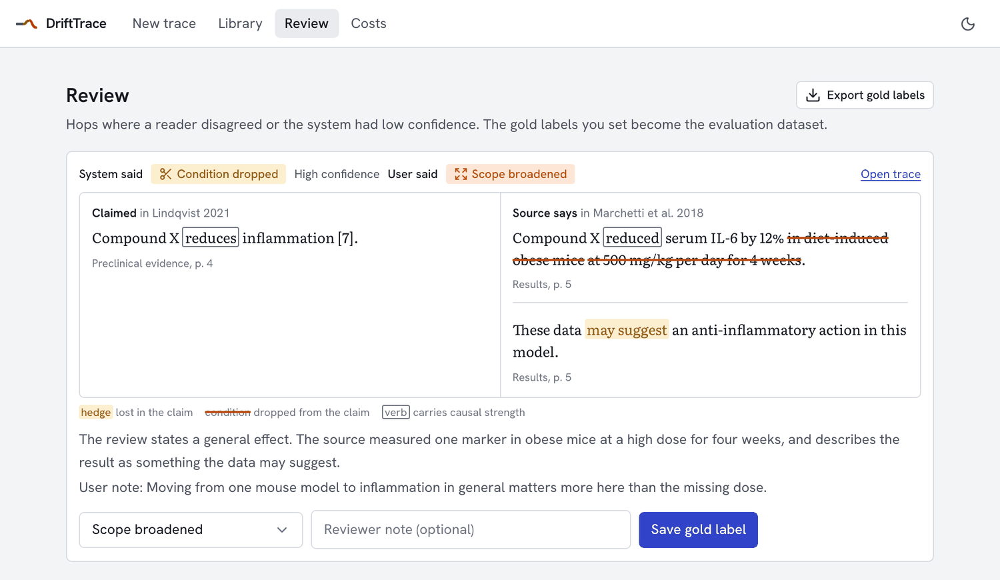
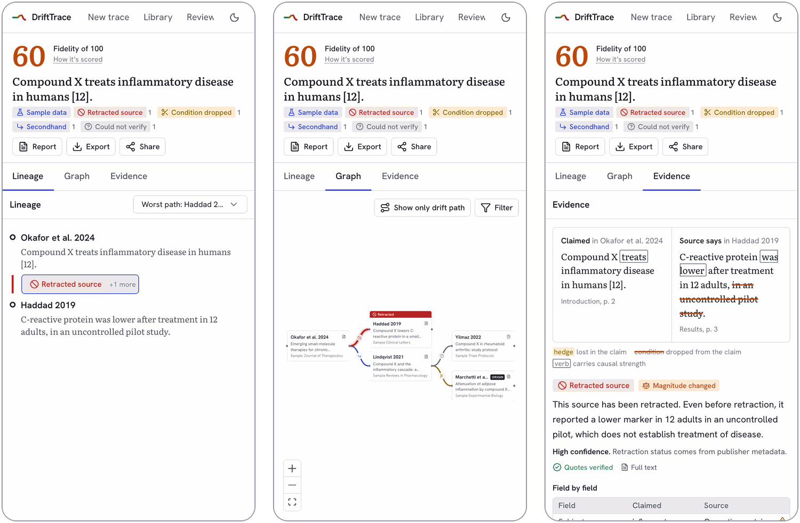
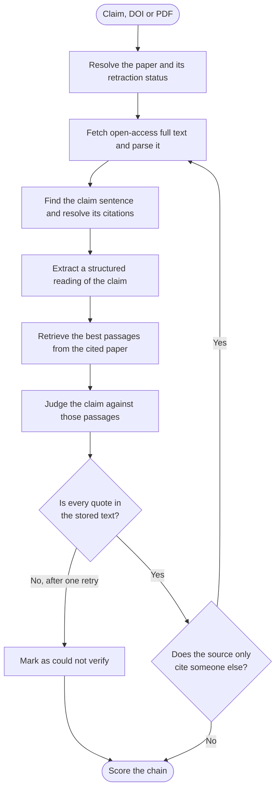

<h1 align="center">DriftTrace</h1>

<p align="center"><b>Follow a scientific claim back through its citations and see exactly where the meaning changed.</b></p>

<p align="center">
  <a href="#quick-start">Quick start</a> &nbsp;&nbsp;
  <a href="#what-a-trace-shows">What a trace shows</a> &nbsp;&nbsp;
  <a href="#how-it-works">How it works</a> &nbsp;&nbsp;
  <a href="#drift-labels">Drift labels</a> &nbsp;&nbsp;
  <a href="#status">Status</a>
</p>

<picture>
  <source media="(prefers-color-scheme: dark)" srcset="docs/readme/drift-story-dark.png">
  
</picture>

Each citation in that chain looks reasonable if you only check the one before it. Read all three together and a 12% change in one marker in mice has become a human treatment. DriftTrace does that reading: it takes a claim, follows the citations back, and puts the exact text from both papers side by side at every hop.

## See it

<p align="center">
  
</p>

<sub>Every image in this README uses the built-in sample trace, which is made of invented papers, except the sentence picker, which shows a real open-access paper. You can load the same trace yourself.</sub>

> [!IMPORTANT]
> DriftTrace has not yet been run end to end against the real model, so how accurate its labels are is unknown. See [Status](#status) for what has and hasn't been tested.

## Quick start

You need Docker and an [Anthropic API key](https://console.anthropic.com/).

```bash
cp .env.example .env     # then set ANTHROPIC_API_KEY and CONTACT_EMAIL
docker compose up --build
```

Open <http://localhost:3000>. The first build takes a while because it installs PyTorch, and the first trace downloads the embedding model. GROBID is an `amd64` image, so on Apple Silicon it runs under emulation and is slower.

To explore the interface without an API key, load the sample trace. It is labeled as sample data wherever it appears.

```bash
docker compose exec backend drifttrace seed-sample
```

## What a trace shows

### The evidence for every hop

Click any citation in the graph to compare the two papers. Dropped conditions are struck through, lost hedges are highlighted, and the verbs that carry causal strength are boxed. Below that, the claim and the source are compared field by field. If you disagree with a verdict, you can correct it.



### The whole citation tree

The score, the lineage and the graph share one workspace. Retracted sources are flagged on the node itself, and the worst path can be isolated with one click.

<picture>
  <source media="(prefers-color-scheme: dark)" srcset="docs/readme/workspace-dark.png">
  
</picture>

### Start from the sentence you doubt

Enter a DOI and pick a citing sentence from the paper's own text, upload a PDF and select one, or type a free-text claim.

<p align="center">
  
</p>

### Reports you can share

Every trace becomes a printable report containing the quotes, the methodology, the scoring formula and the limitations. Traces can also be exported as Markdown, PDF or JSON, or shared by link.

<p align="center">
  
</p>

### Human review feeds the evaluation set

Hops where a reader disagreed, or where confidence was low, go to a review queue. The gold labels set there export in the same format as the evaluation dataset.



### Also on your phone

<p align="center">
  
</p>

## How it works



Retrieval combines BM25 and embeddings, then a language model reranks the results. Metadata comes from OpenAlex, Semantic Scholar and Crossref. Full text comes from your upload, Unpaywall, Europe PMC, arXiv or publisher open access.

These rules are enforced in code rather than left to the model, in [`judge.py`](backend/drifttrace/pipeline/judge.py) and [`quotes.py`](backend/drifttrace/pipeline/quotes.py):

- **A quotation must occur in the stored text.** Tolerance covers whitespace, line-break hyphens, ligatures and typographic quotes, and numbers must match exactly. A verdict whose quotes fail is retried once, then discarded as unverifiable.
- **An abstract is not enough to condemn a citation.** A source read only as an abstract can never be labeled unsupported, and its confidence is capped at medium.
- **Missing evidence is not bad evidence.** Sources that could not be read add no penalty, and a trace with nothing readable has no score rather than a score of zero.

## Drift labels

| Label | Severity | What happened |
|---|:---:|---|
| Faithful | 0 | The source supports the claim as stated. |
| Secondhand | 0 | The source only cites other work for this, so the trace continues there. |
| Could not verify | 0 | The source could not be read well enough to decide. |
| Hedge lost | 1 | Uncertainty in the source was dropped. |
| Condition dropped | 1 | A dose, duration, subgroup or context was removed. |
| Scope broadened | 2 | The finding was applied to a wider population or setting. |
| Causal inflation | 2 | An association was upgraded to causation. |
| Magnitude changed | 2 | An effect size or number was changed or overstated. |
| Contradicted | 3 | The source reports the opposite or a null result. |
| Not in source | 3 | The claim does not appear anywhere in the source. |
| Retracted source | 3 | The source is retracted or has an expression of concern. |

### The score is plain arithmetic

Fidelity is 100 minus the penalty of the worst path through the tree. Each hop's penalty is its severity penalty multiplied by a confidence weight, and each secondary label adds 25% of its own penalty.

| Severity | Penalty | | Confidence | Weight |
|:---:|:---:|---|:---:|:---:|
| 0 | 0 | | High | 1.0 |
| 1 | 8 | | Medium | 0.75 |
| 2 | 18 | | Low | 0.5 |
| 3 | 35 | | | |

In the sample trace, the worst path is the single hop to the retracted paper. Its penalty is 35 for the retraction plus 4.5 for a secondary magnitude change, or 39.5 in total, which leaves a displayed score of 60. The formula is shown in the app and printed in every report.

## Development

The backend needs Python 3.11 or later, Postgres with pgvector, and Redis. The frontend needs Node 22 or later.

```bash
cd backend && pip install -e '.[dev]'
alembic upgrade head
uvicorn drifttrace.api.main:app --reload
arq drifttrace.worker.WorkerSettings

cd frontend && npm install && npm run dev
```

Command-line tools:

```bash
drifttrace ingest 10.1371/journal.pone.0005738          # print sentences with resolved citations
trace-hop 10.1371/journal.pone.0005738 "<sentence>"     # judge one sentence
```

Tests:

```bash
TEST_DATABASE_URL=postgresql+psycopg://... pytest       # unit and pipeline tests, with external APIs and the model stubbed
TEST_DATABASE_URL=postgresql+psycopg://... pytest --live # also ingests five real open-access papers
```

`python -m tests.e2e_worker` runs the real worker with canned model answers, which exercises the whole stack without an API key. Its verdicts mean nothing.

Prompts are versioned files in `backend/prompts/`. The highest `.vN.md` for a name is used.

## Evaluation

`make eval` runs the single-hop judge over `eval/gold.jsonl` and reports per-label precision and recall, a confusion matrix, the quote-failure rate and the cost per hop. It calls the model and spends API credit. Run it before merging any prompt change.

The gold set has 70 hops. 48 are adapted from [SciFact](https://github.com/allenai/scifact) (CC BY-NC 2.0). 22 were written by the developers to cover kinds of drift SciFact lacks, and have not been reviewed by domain experts. `eval/build_gold.py` documents the mapping. Review mode exports expert labels in the same format, and those should gradually replace the authored hops.

## Status

| Milestone | State |
|---|---|
| M0 Scaffold | Done. `docker compose` has not been run yet (see below) |
| M1 Ingestion | Done. Five real papers ingested live |
| M2 Single-hop judge and eval harness | Code done. No baseline score yet |
| M3 Recursion, scoring, queue, SSE | Done |
| M4 Frontend | Done |
| M5 Feedback, Review, Library, Export, Share | Done |
| M6 Dark mode, accessibility, cost dashboard, error states | Done |

Not yet verified:

- **The judge has never run against the real model.** Every test uses a stand-in for the LLM, so label quality is unmeasured. Run `make eval` first. The code targets `claude-opus-5-5` by default, and the request shape has not been accepted by the live API.
- **`docker compose up` has not been run.** The services were tested individually, outside Docker, on Python 3.11.
- **GROBID has not been run live.** The TEI parser is tested on a fixture modeled on GROBID's format. Until GROBID is confirmed, treat PDF parsing as unproven. Sources available from Europe PMC do not depend on it, and without GROBID PDFs fall back to plain text at lower confidence.

Known limitations:

- Plain-text PDF extraction cannot see superscript citation markers, so such papers need GROBID or Europe PMC.
- Europe PMC's full-text endpoint can return errors for minutes at a time. A paper affected this way shows as abstract-only with a note, and is retried on its next use.
- Single user, with no authentication, by design for v1.
